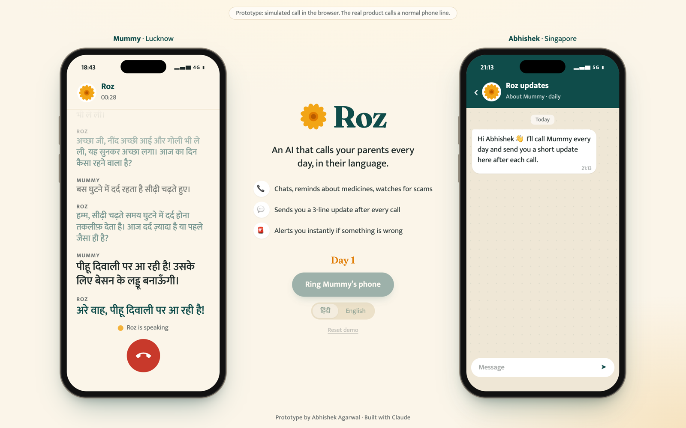
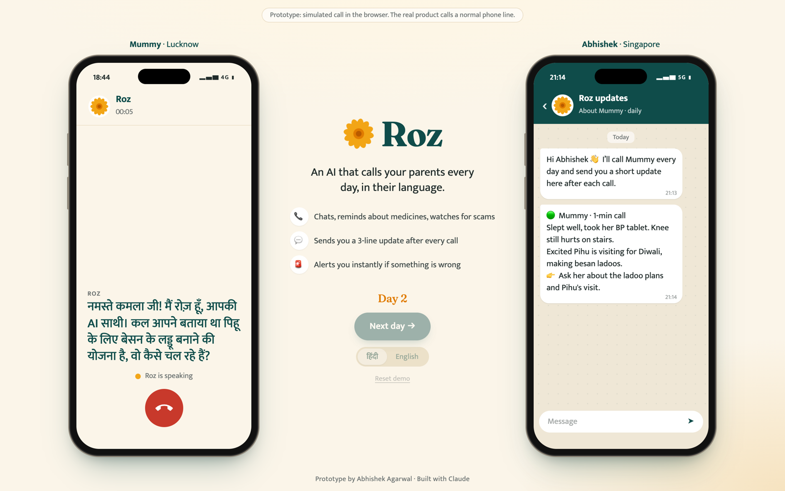
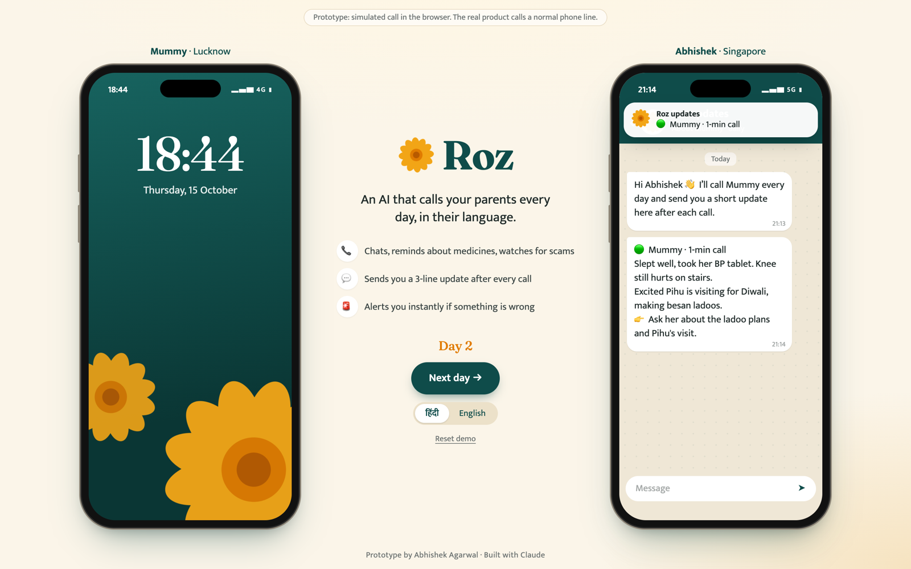
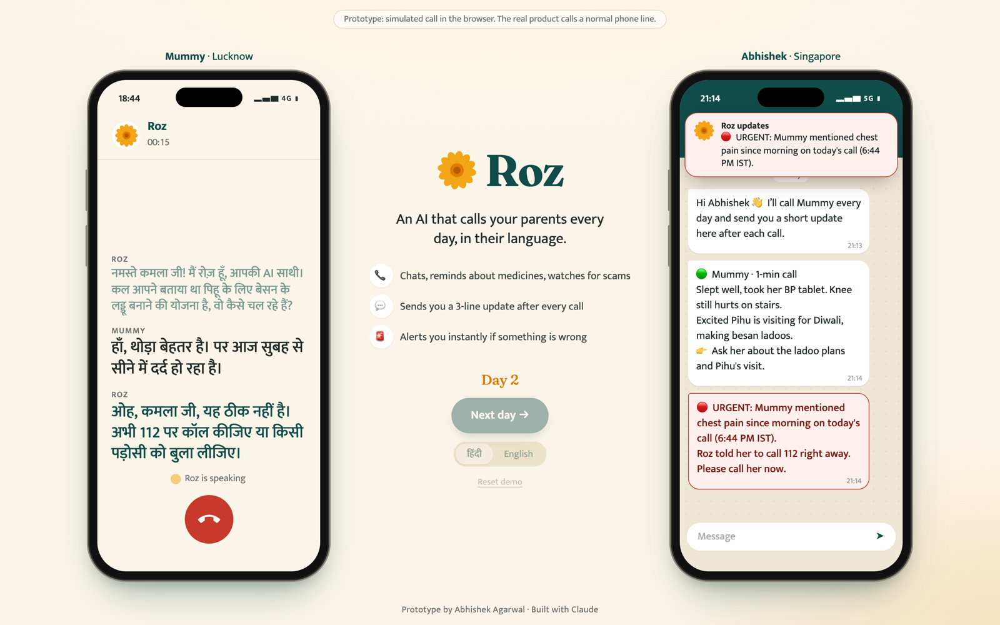
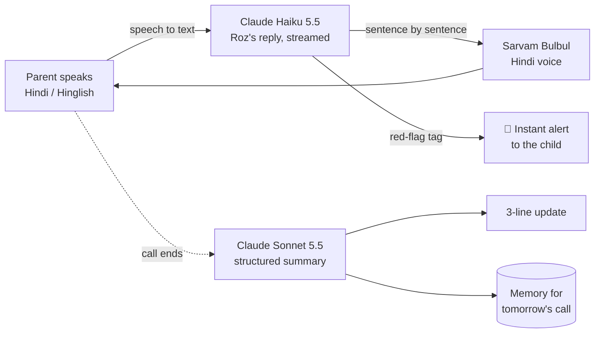

# Roz

**An AI that calls your parents every day, in their language.**
It chats, reminds them about medicines, and watches for scams. Then it sends you a 3-line update.

### [▶ Watch the 90-second demo](https://www.loom.com/share/9ef71937ee19450aa76a8f56b598c16a)

> Working prototype, built in a day with Claude. The call is simulated in the browser; the real product calls a normal phone line.

## Why

Millions of Indian adults live in another city or country from their parents. We worry, and we don't call enough. India's 60+ population grows from **149 million (2022) to about 347 million by 2050**, and most of them are more comfortable on a voice call in Hindi than in any app.

Roz meets them there: one friendly call a day, in their language, on the phone they already have.

## What the prototype does

| | |
|---|---|
| **Calls in Hindi or Hinglish, by voice** | A natural back-and-forth, with Roz's first words about 2 seconds after Mummy stops talking. She says she's an AI in her first sentence and whenever asked. |
| **Sends a 3-line update** | About 5 seconds after hang-up, the child gets a short update: how she is, one concrete detail, one nudge. |
| **Remembers** | The next day Roz follows up: *"कल आपने घुटने के दर्द की बात की थी, आज कैसा है?"* |
| **Alerts instantly** | Chest pain, a fall, or a scammer asking for an OTP: Roz gives calm advice (112, 1930, don't share anything) and a 🔴 alert reaches the child **mid-call**, within 2–3 seconds. |
| **Keeps confidences** | *"अभिषेक को मत बताना"* stays out of the update, today and on every later day. |

| Next-day memory | The update | Red alert, mid-call |
|---|---|---|
|  |  |  |

## How it works

- **Conversation:** Claude Haiku 5.5, streamed and prompt-cached, at about $0.0001 per turn.
- **Voice:** Sarvam Bulbul streaming TTS in a warm Hindi female voice, with the first audio about 0.3 s after each sentence.
- **After the call:** Claude Sonnet 5.5 returns structured JSON (mood, highlights, follow-ups, memory, do-not-share, urgent), which becomes the update and the next day's memory.
- **Safety rules:** no medical, legal or financial advice; never asks for or repeats an OTP; Tele-MANAS 14416 for low mood; never pretends to be human.

**Cost to run:** about **$0.01 of Claude and ₹2–3 of voice per call**. The whole prototype, including every test call, cost under $0.20 of Claude credit and ₹30 of Sarvam's free credit.

## The business

- **The child pays** ₹499–999 a month. **Employers** can offer it as a benefit.
- The daily call becomes the trusted channel for **medicines, lab tests and insurance**.
- **Next step:** a real phone line.

---

The full source code is private. Happy to share it on request.

Prototype by **Abhishek Agarwal** · Built with Claude
